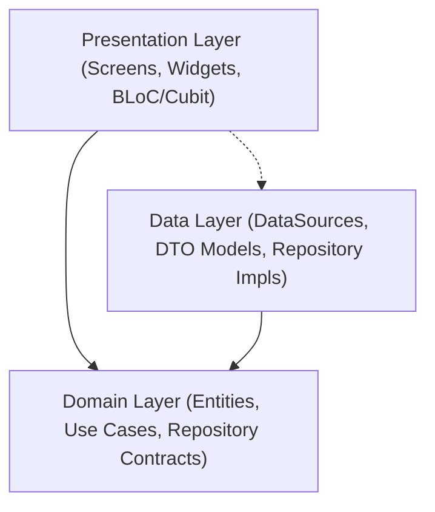

# Flutter Mobile Agent Rules & Architecture Guide (rentbd_app/AGENTS.md)

> **Scope:** `RentBD/rentbd_app/`  
> **Framework:** Flutter 3.x (Dart 3.x)  
> **Platforms:** Android & iOS  
> **State Management:** BLoC / Cubit (`flutter_bloc`)  
> **Network Engine:** Dio with Centralized Interceptors & Token Management  

---

## 1. Feature-First Clean Architecture

The Flutter codebase strictly enforces Feature-First Clean Architecture. Code within each feature is partitioned into three distinct layers with unidirectional dependencies:



### 1.1 Layer Directory Breakdown
```
lib/features/<feature_name>/
├── presentation/
│   ├── bloc/          # State management (Events, States, Blocs)
│   ├── screens/       # Page-level route destinations
│   └── widgets/       # Feature-specific reusable UI components
├── domain/
│   ├── entities/      # Immutable business models (equatable)
│   ├── repositories/  # Abstract repository interface contracts
│   └── usecases/      # Single-responsibility business use cases
└── data/
    ├── datasources/   # Remote (Dio) and local caching sources
    ├── models/        # DTO models with fromJson / toJson mapping
    └── repositories/  # Concrete repository implementations
```

### 1.2 Architectural Rules
1. **Domain Layer Independence:** `domain/` must contain zero Flutter UI imports, zero Dio references, and zero JSON parsing logic.
2. **DTO to Entity Mapping:** API JSON responses must deserialize into `data/models/` and map to immutable `domain/entities/` before reaching BLoCs or presentation widgets.
3. **Immutability:** All BLoC States, Events, and Domain Entities must extend `Equatable` or use `@immutable`.

---

## 2. API & Network Governance

### 2.1 Centralized Dio Client & Environment Configuration
- **No Hardcoded URLs:** Never use literal strings like `'http://127.0.0.1:8000'` in data sources. All network calls must pass through `DioClient` referencing `AppEnvironment.baseUrl`.
- **Dynamic Platform Host Binding:** `AppEnvironment` dynamically resolves `http://10.0.2.2:8000/api/v1` for Android Emulators and `http://127.0.0.1:8000/api/v1` for iOS Simulators / macOS Desktop.

### 2.2 JWT Authentication & Silent Refresh Interceptor
All authenticated requests are managed through `AuthInterceptor`:
1. **Bearer Token Injection:** Automatically attaches `Authorization: Bearer <access_token>` from `TokenManager`.
2. **Transparent 401 Silent Refresh:** When an API request encounters a `401 Unauthorized`:
   - Enqueues the failing request.
   - Executes a synchronized refresh call using the 7-day refresh token (`POST /api/v1/auth/token/refresh/` or `/auth/otp/verify/`).
   - If successful, updates in-memory and persistent token storage and replays all queued requests with the new access token.
   - If the refresh token is expired or invalid, clears session state and invokes `TokenManager.onSignOut()`.
3. **Sanitized Error Messaging:** Server error payloads must be parsed cleanly via `Failure` classes without leaking raw HTML or technical socket traces to the user interface.

---

## 3. Platform & UX Specific Guidelines

### 3.1 In-App Camera & EXIF GPS Preservation
- For **60-Second Quick Post** and live photo uploads, utilize the in-app camera plugin rather than the generic gallery picker when requesting the **"Verified Real Photo"** badge.
- Ensure device camera permissions (`ACCESS_FINE_LOCATION` and `CAMERA`) are active so hardware GPS tags are preserved in the binary JPEG EXIF header, enabling backend delta verification ($\le 50\text{m}$).

### 3.2 Freehand Canvas Drawing for Spatial Polygon Search
- The map search view (`map_search_screen.dart`) layers a transparent `CustomPaint` canvas over `GoogleMap`.
- Capture touch gestures (`GestureDetector` with `onPanUpdate` and `onPanEnd`) to record latitude/longitude polyline points.
- Close the polygon upon gesture release and convert coordinates into a GeoJSON-compatible coordinate array for `POST /api/v1/properties/spatial/polygon-search/`.

### 3.3 Masked VoIP Integration (`agora_rtc_engine`)
- Fetch time-bounded Agora RTC channel tokens via `POST /api/v1/chat/calls/generate-token/`.
- Initialize `RtcEngine` with audio-only or video profile.
- Display call timer, mute toggle, and speakerphone controls while hiding both users' real phone numbers.

### 3.4 Multilingual Text & Voice Search
- Support natural search input in **English**, **Bangla script (বাংলা)**, and **Banglish (phonetic)**.
- Transmit the raw search query directly to `POST /api/v1/properties/ai/search/` so the backend NLP engine can extract budgetary bounds, bedroom counts, and neighborhood entities.

---

## 4. Testing & Verification Gate Protocol

Flutter agents must execute static analysis and all automated test suites before declaring work complete:

```bash
cd rentbd_app

# 1. Static Analysis (Zero warnings, zero hints allowed)
flutter analyze

# 2. Complete Unit, Model, BLoC, and Network Test Suite
flutter test
```

### Quality Acceptance Criteria:
- **Zero Analysis Errors/Warnings:** Must conform to `analysis_options.yaml`.
- **Zero Test Regressions:** All 26+ test cases in `test/` (including `error_handling_test.dart`, `property_model_test.dart`, `auth_interceptor_test.dart`, `repository_zero_rework_test.dart`) must pass with 100% green status.
